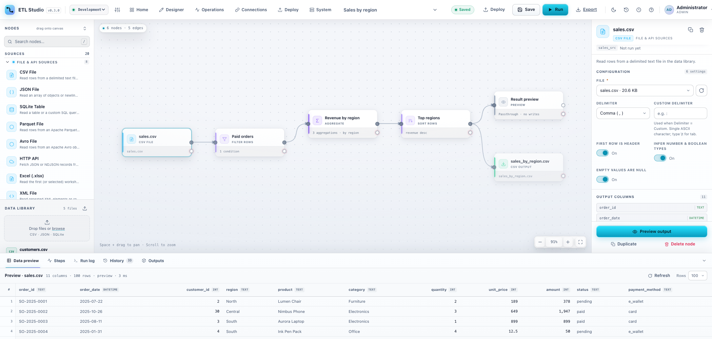

# ETL Studio

A web-based, drag-and-drop **ETL pipeline builder** with a Rust backend and a
Rust/WASM frontend.



> **Container image:** `ghcr.io/suryandi-wijaya/etl-rust` — public.
> This repository holds the public setup guide; the application source code is private.

## Why Rust?

- **No JVM or Node.js runtime.** The backend, scheduler, worker and UI all ship
  as native Rust/WASM artifacts, so the container only contains the app, not a
  large language runtime.
- **Small memory footprint.** The idle web process typically uses tens of MB of
  RSS (roughly 40–60 MB in a minimal single-container install); memory grows with
  active pipelines, connectors and dataset size rather than with a VM heap.
- **Predictable latency.** No garbage-collector pauses while executing a
  pipeline or streaming a large result.
- **Memory and thread safety.** The engine, API and permission checks are
  compiled with Rust's ownership guarantees; data races and use-after-free are
  rejected at compile time.
- **Fast startup.** The container becomes healthy in seconds, which keeps
  worker scale-up/scale-down responsive.
- **Compact multi-arch image.** Around 440 MB uncompressed for both
  `linux/amd64` and `linux/arm64`.

## Setup

### 1. Download the image

```bash
docker pull ghcr.io/suryandi-wijaya/etl-rust:latest
```

If the pull is denied, the package may still be private or the visibility change
is still propagating — see the FAQ.

### 2. Create the `.env` file

In an empty folder, create `.env`:

```dotenv
ETL_SEED_ADMIN_PASSWORD=ChangeMe123
ETL_PG_PASSWORD=change-me-postgres
```

### 3. Create `docker-compose.yml`

Create `docker-compose.yml` in the same folder. It starts the UI/API, PostgreSQL,
the scheduler and one worker:

```yaml
name: etl-studio

services:
  postgres:
    image: postgres:16-alpine
    restart: unless-stopped
    environment:
      POSTGRES_USER: etl
      POSTGRES_PASSWORD: ${ETL_PG_PASSWORD:-change-me-postgres}
      POSTGRES_DB: etl
    volumes:
      - etl-pg:/var/lib/postgresql/data
    healthcheck:
      test: ["CMD-SHELL", "pg_isready -U etl -d etl"]
      interval: 10s
      timeout: 5s
      retries: 5

  etl-studio:
    image: ghcr.io/suryandi-wijaya/etl-rust:latest
    restart: unless-stopped
    ports:
      - "8787:8787"
    environment:
      ETL_SEED_ADMIN_PASSWORD: ${ETL_SEED_ADMIN_PASSWORD:-}
      ETL_EXECUTION_MODE: queue
      ETL_SCHEDULER_ENABLED: "0"
      ETL_ALLOW_MANAGED_WORKERS: "0"
      ETL_ALLOW_EXTERNAL_WORKER_CREATION: "1"
      ETL_NODE_RETRY_ATTEMPTS: "1"
      ETL_NODE_RETRY_DELAY_MS: "500"
      ETL_DATABASE_URL: "postgres://etl:${ETL_PG_PASSWORD:-change-me-postgres}@postgres:5432/etl"
      ETL_PG_SYNC_SECS: "5"
    volumes:
      - etl-data:/data
      - /var/run/docker.sock:/var/run/docker.sock
    depends_on:
      postgres:
        condition: service_healthy

  scheduler:
    image: ghcr.io/suryandi-wijaya/etl-rust:latest
    restart: unless-stopped
    depends_on:
      etl-studio:
        condition: service_healthy
    environment:
      ETL_ROLE: scheduler
      ETL_ROOT: /data
      ETL_EXECUTION_MODE: queue
      ETL_SCHEDULER_INTERVAL_SECS: "20"
    volumes:
      - etl-data:/data

  worker:
    image: ghcr.io/suryandi-wijaya/etl-rust:latest
    restart: unless-stopped
    depends_on:
      etl-studio:
        condition: service_healthy
    environment:
      ETL_ROLE: worker
      ETL_ROOT: /data
      ETL_EXECUTION_MODE: queue
      ETL_WORKER_CONCURRENCY: "1"
      ETL_WORKER_RETIRE_WHEN_EMPTY: "0"
      ETL_NODE_RETRY_ATTEMPTS: "1"
      ETL_NODE_RETRY_DELAY_MS: "500"
    volumes:
      - etl-data:/data

volumes:
  etl-data:
  etl-pg:
```

> The `/var/run/docker.sock` mount lets the web container create and retire
> external workers from **System → Workers**. If you do not need that, remove the
> socket line and set `ETL_ALLOW_EXTERNAL_WORKER_CREATION: "0"`.

### 4. Start the stack

```bash
docker compose up -d
```

Check that everything is healthy:

```bash
docker compose ps
```

### 5. Sign in

Open <http://localhost:8787> and sign in with `admin` / `ChangeMe123` **on a
new, empty volume** (or `admin123` if `ETL_SEED_ADMIN_PASSWORD` was omitted).
If you have started this stack before, the existing volume keeps the old admin
password — use `admin` / `admin123` first, then change it from the account menu.

`ETL_SEED_ADMIN_PASSWORD` is only applied on the very first run when
`/data/auth.db` does not exist; changing `.env` later does not reset an existing
password.

You can now create a pipeline in **Designer**, run it, and manage schedules,
workers, connections and environments from the UI.

---

## FAQ

<details>
<summary><strong>Can I run one container without Compose?</strong></summary>

Yes. macOS / Linux:

```bash
docker volume create etl-data
docker run -d --name etl-studio --restart unless-stopped \
  -p 8787:8787 -v etl-data:/data \
  ghcr.io/suryandi-wijaya/etl-rust:latest
```

Windows PowerShell:

```powershell
docker volume create etl-data
docker run -d --name etl-studio --restart unless-stopped `
  -p 8787:8787 -v etl-data:/data `
  ghcr.io/suryandi-wijaya/etl-rust:latest
```

Scheduled/queued runs need the scheduler and worker services from the YAML
above.
</details>

<details>
<summary><strong>Why doesn't the password from `.env` work?</strong></summary>

`ETL_SEED_ADMIN_PASSWORD` is a **first-run seed only**. It is used when the
container creates `/data/auth.db` for the first time. If the `etl-data` volume
(or the PostgreSQL mirror in `etl-pg`) already exists, the password and users are
restored from there, so `.env` changes are ignored.

- Existing installation: sign in with the previous password (default
  `admin` / `admin123`) and change it from the account menu.
- Truly fresh start: `docker compose down -v` deletes all volumes, including
  pipelines and users, then `docker compose up -d` seeds `ChangeMe123` again.
- Never run `docker compose down -v` on an installation whose data you need.

</details>

<details>
<summary><strong>Where is my data and how do I back it up?</strong></summary>

Everything lives in the `etl-data` volume (`/data` in the container):
pipelines, runs, datasets, outputs, `auth.db`, `connections/` and `secret.key`.
Postgres stores the durable mirror in `etl-pg`.

Back up both volumes while the stack is stopped:

```bash
docker compose down
docker run --rm -v etl-studio_etl-data:/data -v "$PWD":/backup alpine \
  tar czf /backup/etl-data-backup.tgz -C /data .
docker run --rm -v etl-studio_etl-pg:/data -v "$PWD":/backup alpine \
  tar czf /backup/etl-pg-backup.tgz -C /data .
docker compose up -d
```

Windows PowerShell: use `${PWD}:/backup` instead of `"$PWD":/backup`.
</details>

<details>
<summary><strong>What is secret.key / ETL_SECRET_KEY?</strong></summary>

Connections are encrypted with AES-256-GCM. On first start the server creates
`/data/secret.key`; it is included in the `etl-data` backup. Without it, saved
connections cannot be decrypted. You can supply a persistent base64 32-byte key
with `ETL_SECRET_KEY` instead. Never generate a new key for existing data.
</details>

<details>
<summary><strong>How do I update or roll back?</strong></summary>

```bash
docker compose pull
docker compose up -d
```

Pin a version in the YAML (`:0.1.0` instead of `:latest`) for reproducible
deployments. Data stays in the volumes.
</details>

<details>
<summary><strong>Apple Silicon / arm64?</strong></summary>

The image is multi-arch (`linux/amd64` + `linux/arm64`), so no `--platform` flag
is needed. If your Docker or registry mirror lacks arm64, pull with
`--platform linux/amd64`.
</details>

<details>
<summary><strong>The image pull is denied.</strong></summary>

The package may still be private or GitHub visibility is still propagating.
Authenticate with a classic token that has `read:packages`:

```bash
echo "$CR_PAT" | docker login ghcr.io -u suryandi-wijaya --password-stdin
```

Then retry `docker compose pull`.
</details>

<details>
<summary><strong>How do environments and deployments work?</strong></summary>

Use the environment switcher in the top bar to choose **Development**, **Test**,
**Production**, or a custom environment. Click the sliders button next to the
switcher to add or remove environments. Each environment has its own pipeline
documents and folder counts, so designs and versions are independent.

The three defaults are seeded on first start; **Development** is the protected
default. Custom environments can be removed once they contain no pipelines.

Open a pipeline and click **Deploy** in the Studio top bar to copy the current
design to another environment. The first deployment creates a copy; later
deployments update the matching pipeline in place (same pipeline key) and carry
the source version. The target card shows its environment and `vN`; every save
bumps the version of the pipeline you are editing.

Connections are scoped to environments. Deployment remaps a node's selected
connection by **name + kind** to the matching connection in the target
environment; if it does not exist yet the deployment fails and asks you to create
it first.

</details>

<details>
<summary><strong>How does automatic retry work?</strong></summary>

Failed nodes are retried automatically before the run fails. Configure it with:

- `ETL_NODE_RETRY_ATTEMPTS` — retries per node (default `1` in the Compose stack,
  `0` when unset outside Docker)
- `ETL_NODE_RETRY_DELAY_MS` — wait between attempts (default `500`)

Successful nodes are not re-executed; only the failed node is retried and the
run continues once it succeeds. Sinks are never retried to avoid duplicate
writes. Retries are recorded in the node log on the Steps tab.

A `Delay (test)` node is available in the palette to build long-running test
pipelines (for example 300000 ms = 5 minutes).
</details>

<details>
<summary><strong>How do I create a worker from the UI?</strong></summary>

Open **System → Workers → New external worker**. The web container creates a
Docker worker container that shares the workspace and network with the web
container; the new card appears as **External** after its first heartbeat.

This requires the Docker socket mount and
`ETL_ALLOW_EXTERNAL_WORKER_CREATION=1` (already set in both Compose files).
The worker uses the same image and `etl-worker` binary. Already-running workers
created this way can be edited from **System → Workers → Edit** (name,
concurrency, max rows, CPU/memory limits). Editing recreates the container with
the new limits, so an active job is interrupted. Removing the container stops
it; Compose-scaled workers are managed with
`docker compose up -d --scale worker=N`.

> Mounting `/var/run/docker.sock` gives the web container host-level Docker
> access. Keep the UI behind HTTPS/trusted users, or disable
> `ETL_ALLOW_EXTERNAL_WORKER_CREATION` and scale workers with Compose instead.
</details>

<details>
<summary><strong>How do I get scheduled runs and multiple workers?</strong></summary>

Use the `scheduler` and `worker` services from the YAML above, then scale:

```bash
docker compose up -d --scale worker=3
```

All pipeline runs (Studio **Run**, Operations and schedules) are queued for
workers; the web process never executes pipelines inline.
</details>

<details>
<summary><strong>How do I build from source or develop locally?</strong></summary>

Access to the private repository is required.

```bash
git clone https://github.com/suryandi-wijaya/etl-rust.git
cd etl-rust
make dev        # Docker queue stack: web + scheduler + worker + autoscaler
make dev-ui     # terminal 2: incremental Trunk UI, mounted into the dev stack
```
</details>

<details>
<summary><strong>Security notes</strong></summary>

- Change the seeded `admin` password immediately.
- Put the app behind HTTPS/reverse proxy; do not expose port `8787` publicly.
- Keep `/data` and backups private; they contain credentials.
- The Docker socket mount gives the web container host-level Docker access; only
  enable it for trusted administrators, or remove it and scale Compose workers.
- Runtime storage can be large; monitor disk usage on the System page.
</details>

<details>
<summary><strong>How are image releases published?</strong></summary>

Manually: **Actions → Publish GHCR (multi-arch, manual) → Run workflow** with a
version tag. Pushing to `main` does not publish an image.
</details>

## License

MIT.
